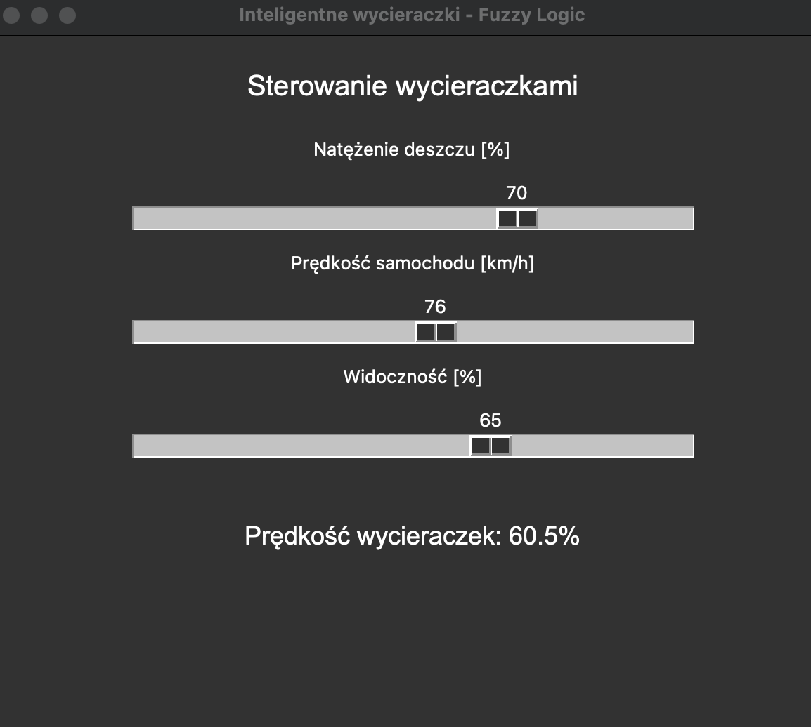

# FuzzyWipers – Fuzzy Logic

Projekt wykonany w ramach przedmiotu  
**NAI – Narzędzia Sztucznej Inteligencji**

## Autorzy

- Łukasz Dahm
- Michał Kujawa

## Opis projektu

Projekt przedstawia prosty system sterowania prędkością wycieraczek samochodowych wykorzystujący **logikę rozmytą (Fuzzy Logic)**.

System na podstawie trzech wartości wejściowych określa odpowiednią prędkość pracy wycieraczek.

Program posiada graficzny interfejs użytkownika z suwakami, dzięki czemu można obserwować działanie systemu w czasie rzeczywistym.

## Wejścia systemu

System wykorzystuje trzy wartości wejściowe:

1. **Natężenie deszczu** – od 0% do 100%.
2. **Prędkość samochodu** – od 0 km/h do 140 km/h.
3. **Widoczność** – od 0% do 100%.

## Wyjście systemu

System posiada jedno wyjście:

- **Prędkość pracy wycieraczek** – od 0% do 100%.

## Logika rozmyta

Program wykorzystuje trzy podstawowe funkcje przynależności:

- `LOW` – wartość niska,
- `MEDIUM` – wartość średnia,
- `HIGH` – wartość wysoka.

Funkcje przynależności określają stopień, w jakim dana wartość należy do określonego zbioru rozmytego.

Stopień przynależności przyjmuje wartość od `0` do `1`.

Przykładowo natężenie deszczu może jednocześnie należeć częściowo do zbioru `MEDIUM` oraz częściowo do zbioru `HIGH`.

## Fuzzification

Pierwszym etapem działania systemu jest **fuzzification**, czyli rozmywanie danych wejściowych.

Konkretne wartości, np.:

- deszcz: 70%,
- prędkość: 100 km/h,
- widoczność: 30%

są zamieniane na stopnie przynależności do zbiorów:

- LOW,
- MEDIUM,
- HIGH.

## Reguły IF–THEN

Po rozmyciu wartości wejściowych system wykorzystuje reguły sterujące.

Przykładowe reguły:

- IF rain is LOW THEN wiper speed is VERY LOW.
- IF rain is MEDIUM THEN wiper speed is MEDIUM.
- IF rain is HIGH THEN wiper speed is HIGH.
- IF visibility is POOR THEN wiper speed is HIGH.
- IF speed is HIGH AND rain is MEDIUM OR HIGH THEN wiper speed is VERY HIGH.
- IF rain is LOW AND visibility is GOOD THEN wiper speed is VERY LOW.

## Operatory rozmyte

W projekcie wykorzystywane są podstawowe operatory logiki rozmytej:

- **AND** – realizowany za pomocą funkcji `min()`,
- **OR** – realizowany za pomocą funkcji `max()`.

## Defuzzification

Po wykonaniu reguł system musi uzyskać jedną konkretną wartość wyjściową.

W projekcie wyniki reguł są łączone przy użyciu **średniej ważonej**.

Wynikiem jest konkretna prędkość pracy wycieraczek, np.:

```text
Prędkość wycieraczek: 76.4%
```

## Interfejs użytkownika

Interfejs programu został wykonany przy użyciu biblioteki **Tkinter**.

Program posiada trzy suwaki:

- natężenie deszczu,
- prędkość samochodu,
- widoczność.

Zmiana wartości dowolnego suwaka powoduje natychmiastowe ponowne obliczenie prędkości wycieraczek.

Dzięki temu działanie systemu można obserwować w czasie rzeczywistym.

## Wymagania

Do uruchomienia projektu wymagane są:

- Python 3,
- Tkinter.

Projekt nie wymaga instalowania dodatkowych bibliotek Python.

## Uruchomienie

W terminalu należy przejść do folderu projektu:

```bash
cd NAI_02_FuzzyWipers
```

Następnie uruchomić:

```bash
python3 main.py
```

Po uruchomieniu pojawi się okno aplikacji.

## Struktura projektu

```text
NAI_02_FuzzyWipers/
├── main.py
├── README.md
└── screenshot.png
```

## Przykładowe działanie

Przykład:

```text
Natężenie deszczu: 80%
Prędkość samochodu: 120 km/h
Widoczność: 20%

Prędkość wycieraczek: wysoka
```

Dokładna wartość wyjściowa jest obliczana przez system logiki rozmytej.

## Screenshot

Przykładowe działanie programu zostało przedstawione w pliku:

